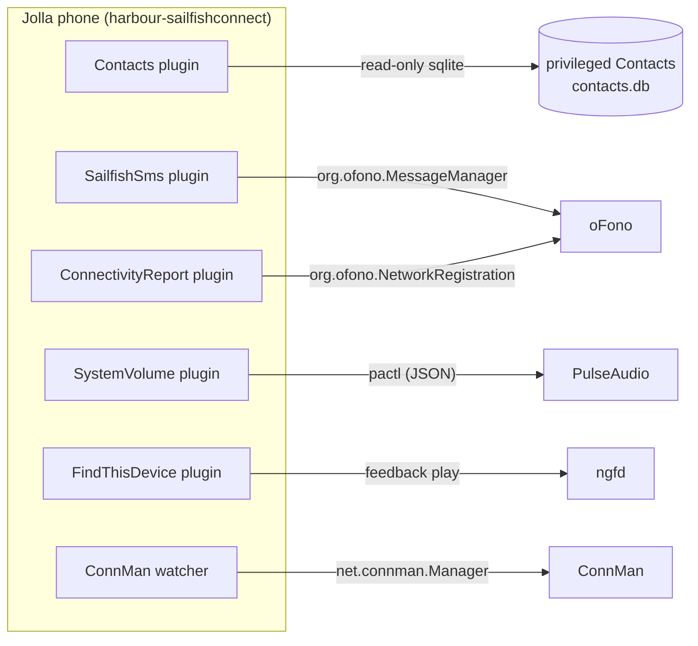

# Device-side setup

Some plugins need a permission or a service that the Sailfish OS base system
does not grant by default. The RPM does not change the system: apply the
steps below once per device, and again after an operating system update if the
file that carries them is a system file.



## Contacts

The contacts database lives under the privileged data directory, which only
the `privileged` group can cross:

```
/home/defaultuser/.local/share/system/privileged/Contacts/qtcontacts-sqlite/contacts.db
```

Add the session user to that group, then **reboot** (or log out and in): the
systemd user manager keeps the supplementary groups of the session it started
with, so a restart of the service is not enough.

```sh
devel-su usermod -aG privileged defaultuser
```

Check that the change is active for the daemon:

```sh
id defaultuser          # lists privileged
pid=$(pgrep -f harbour-sailfishconnect | head -1)
grep Groups /proc/$pid/status
```

## SMS

Sending goes through oFono, which only allows it for the session user once an
access-control rule is in place. The rule and the details are in
[sms-ofono.md](sms-ofono.md).

## System volume

`SystemVolume` drives PulseAudio through `pactl`: the JSON output of
`pactl -f json list sinks` and `pactl subscribe` for the live changes. The
optional PulseAudio D-Bus module is not loaded on Sailfish OS, so nothing has
to be enabled. The pactl calls always run with `LC_ALL=C`, because pactl
translates the event names of `subscribe`.

## FindThisDevice

The ringtone is played with `ngfd`, which is installed on every Sailfish OS
device. No setup is needed.

## Discovery after boot

Qt 5.6 does not report network changes on Sailfish OS, so the daemon watches
ConnMan and re-announces itself when the network comes online. It also
re-announces every five minutes while ConnMan reports `online`, so a
broadcast lost at startup heals without user interaction.

## Verifying the installation

```sh
# The plugins the peer announces and the ones loaded for the desktop device
gdbus call --session --dest org.harbour.SailfishConnect \
    --object-path /modules/kdeconnect/devices/<device id> \
    --method org.kde.kdeconnect.device.loadedPlugins
```

Use the session bus of the user:

```sh
export XDG_RUNTIME_DIR=/run/user/100000
export DBUS_SESSION_BUS_ADDRESS=unix:path=/run/user/100000/dbus/user_bus_socket
```
